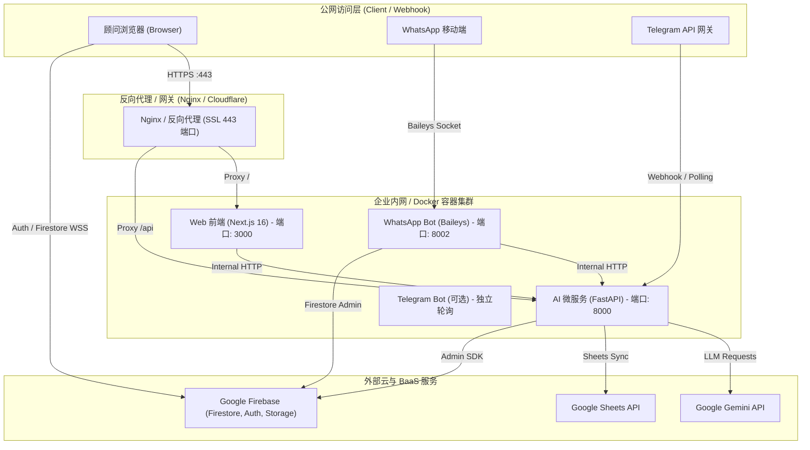

# 🚀 TALENT FLOW (Omni Recruitment Management) - 企业级生产部署指南

本文档专为负责系统部署的 **DevOps 工程师、系统管理员 (IT Admin) 或技术负责人** 编写。系统采用微服务与云原生 BaaS 架构，支持通过 **Docker Compose 一键全栈部署** 或 **独立服务器/虚拟机拆分部署**。

---

## 目录
1. [系统架构与服务端口拓扑](#1-系统架构与服务端口拓扑)
2. [部署前置依赖与凭据准备](#2-部署前置依赖与凭据准备)
3. [环境变量 (ENV) 详尽配置手册](#3-环境变量-env-详尽配置手册)
4. [Firebase 云端数据库与服务初始化 (核心 5 步)](#4-firebase-云端数据库与服务初始化-核心-5-步)
5. [生产部署方案实操](#5-生产部署方案实操)
   - [方案 A：Docker Compose 一键容器化部署 (推荐)](#方案-adocker-compose-一键容器化部署-推荐)
   - [方案 B：传统 Linux VPS / 虚拟机部署 (PM2 + Systemd)](#方案-b传统-linux-vps--虚拟机部署-pm2--systemd)
   - [方案 C：云原生 PaaS 托管 (Vercel + Render)](#方案-c云原生-paas-托管-vercel--render)
6. [服务验收与常见故障排查 (FAQ)](#6-服务验收与常见故障排查-faq)

---

## 1. 系统架构与服务端口拓扑

TALENT FLOW 生产环境由以下核心服务构成：

### 架构全景拓扑图 (ASCII 视图，免插件直接查看)
```text
┌────────────────────────────────────────────────────────────────────────┐
│                      公网访问层 (Public Network)                         │
│  [顾问浏览器]            [顾问 WhatsApp 手机]           [Telegram 服务器] │
└───────┬──────────────────────────┬─────────────────────────────┬───────┘
        │ HTTPS :443 (用户操作)       │ Baileys Socket 扫码长连       │ Webhook / 轮询
        ▼                          ▼                             ▼
┌────────────────────────────────────────────────────────────────────────┐
│                     反向代理层 (Nginx / Cloudflare)                     │
│  • 域名解析: recruit.yourcompany.com                                     │
│  • 路径分发: / ➔ Web (3000)  |  /api/ ➔ AI Backend (8000)               │
└───────┬────────────────────────────────────────────────────────┬───────┘
        │                                                        │
        ▼                                                        ▼
┌────────────────────────────────────────────────────────────────────────┐
│                    企业内网 / Docker 容器集群 (Core Cluster)             │
│                                                                        │
│   ┌─────────────────────┐   REST API    ┌──────────────────────────┐  │
│   │   🌐 Web 前端       │ ────────────▶ │    ⚡ AI 后端微服务      │  │
│   │   (Next.js 16)      │               │    (Python FastAPI)      │  │
│   │   Port: 3000        │ ◀──────────── │    Port: 8000            │  │
│   └──────────┬──────────┘  /api/rewrites└─────────────┬────────────┘  │
│              │                                        │               │
│              │ WSS/HTTPS                              │ Agent / Push  │
│              │ (直接通信)                              │               │
│              │                                        ▼               │
│              │                          ┌──────────────────────────┐  │
│              │                          │   📱 WhatsApp 机器人     │  │
│              │                          │   (Node.js Baileys)      │  │
│              │                          │   Port: 8002             │  │
│              │                          └─────────────┬────────────┘  │
└──────────────┼────────────────────────────────────────┼───────────────┘
               │                                        │
               ▼                                        ▼
┌────────────────────────────────────────────────────────────────────────┐
│                      外部云与 BaaS 服务 (Cloud Services)                 │
│                                                                        │
│  🔥 Google Firebase                  🧠 大模型 (Gemini API)             │
│  ├── Cloud Firestore (多租户数据库)   ├── Claude Sonnet / Gemini Flash │
│  ├── Authentication (用户身份认证)   └── 简历多模态 OCR 结构化提取      │
│  └── Storage (简历文件云存储)                                           │
│                                      📊 Google Cloud                   │
│                                      └── Sheets API 表格双向同步        │
└────────────────────────────────────────────────────────────────────────┘
```

<details>
<summary><b>👉 点击展开查看 Mermaid 流程图代码 (支持 GitHub / Notion / 渲染器)</b></summary>



</details>

### 端口映射清单
| 服务组件 | 源码目录 | 容器内端口 | 推荐对外映射端口 | 用途说明 |
| :--- | :--- | :---: | :---: | :--- |
| **Web 前端** | `web/` | `3000` | `3000` (或经 80/443 反代) | 核心业务界面、看板、候选人管理 |
| **AI 后端服务** | `ai_backend/` | `8000` | `8000` | 简历解析、JD 生成、考勤合规、Webhook |
| **WhatsApp 机器人** | `whatsapp_bot/` | `8002` | `8002` | 内部跟进到期通知、扫码绑定微服务 |
| **n8n 工作流 (选配)**| `n8n/` | `5678` | `5678` | 可视化自动化工作流编排 |

---

## 2. 部署前置依赖与凭据准备

在正式启动部署前，需提前准备好以下账号与凭据：

### 2.1 依赖环境（若采用自建主机）
- **Docker** 20.10+ 及 **Docker Compose** v2+（容器化部署）
- 或 **Node.js** v20.x+、**Python** 3.10+、**PM2**（裸机部署）

### 2.2 核心云平台账号与密钥
1. **Google Firebase 项目**（必选）：
   - 创建 Firebase 项目，开启 Authentication、Cloud Firestore 与 Cloud Storage；
   - 导出 `firebase-service-account.json`（管理员权限私钥）。
2. **Google Gemini API Key**（必选）：
   - 前往 [Google AI Studio](https://aistudio.google.com/apikey) 创建 API Key，并确认项目已开通计费（免费额度有频率限制）。
3. **Telegram Bot Token**（选配）：
   - 在 Telegram 向 `@BotFather` 发送 `/newbot` 获取机器人口令；
   - 发送 `/setprivacy` 将 Privacy Mode 设为 `Disable`（使机器人可在群组中接收简历附件）。
4. **Google Cloud 服务账号**（选配，仅在需要后台定时同步 Google 表格时需要）：
   - 启用 Google Sheets API，导出 `credentials.json`，并把 Google 表格分享给该账号。

---

## 3. 环境变量 (ENV) 详尽配置手册

### 3.1 Web 前端配置 (`web/.env.production` 或 `web/.env.local`)
对应模板：[`web/.env.example`](file:///c:/Users/sean/Omni_Reruitment_Management/web/.env.example)

```ini
# ==============================================================================
# Web 前端应用环境变量 (Next.js 16)
# ==============================================================================

# Firebase 客户端 SDK 配置 (从 Firebase Console -> 项目设置 -> 常规 -> Web应用中获取)
NEXT_PUBLIC_FIREBASE_API_KEY=AIzaSyxxxxxxxxxxxxxxxxx
NEXT_PUBLIC_FIREBASE_AUTH_DOMAIN=your-project.firebaseapp.com
NEXT_PUBLIC_FIREBASE_PROJECT_ID=your-project-id
NEXT_PUBLIC_FIREBASE_STORAGE_BUCKET=your-project.appspot.com
NEXT_PUBLIC_FIREBASE_MESSAGING_SENDER_ID=123456789012
NEXT_PUBLIC_FIREBASE_APP_ID=1:123456789012:web:abcdef123456

# 后端微服务通讯地址
# PYTHON_API_URL: Next.js 服务端 Rewrite 代理后端地址 (在 Docker 内填 http://ai-backend:8000)
PYTHON_API_URL=http://ai-backend:8000
# NEXT_PUBLIC_PYTHON_API_URL: 浏览器直接访问 AI 后端的地址 (可留空走 Next.js 代理，或填写公网 API 域名)
NEXT_PUBLIC_PYTHON_API_URL=https://api.yourcompany.com

# 初始系统管理员邮箱 (极其关键！)
# 首次登录该邮箱的账号将自动被授予 Owner 团队所有者最高权限，负责审批后续加入的新顾问
NEXT_PUBLIC_ADMIN_EMAIL=admin@yourcompany.com

# 帮助文档路径
NEXT_PUBLIC_DOCS_URL=/docs
```

---

### 3.2 AI 后端配置 (`ai_backend/.env`)
对应模板：[`ai_backend/.env.example`](file:///c:/Users/sean/Omni_Reruitment_Management/ai_backend/.env.example)

```ini
# ==============================================================================
# AI 后端微服务环境变量 (FastAPI)
# ==============================================================================

# Google Gemini API 密钥 (必填)
GEMINI_API_KEY=your_gemini_api_key_here

# 模型分级 (Pro: 订单解析 / AI 助手 / 匹配；Flash: 表格、简历解析与 JD 生成)
GEMINI_MODEL_PRO=gemini-3.1-pro-preview
GEMINI_MODEL_FLASH=gemini-3.8-flash

# 向量嵌入引擎 (选填)
OPENAI_API_KEY=
EMBEDDING_MODEL=text-embedding-3-small
CHROMA_PERSIST_DIR=chroma_data

# Firebase Admin 服务账号 (二选一)
# 选项 A: 指定挂载的 JSON 路径
FIREBASE_SERVICE_ACCOUNT_PATH=firebase-service-account.json
# 选项 B: 直接粘贴完整的 JSON 字符串 (云原生部署推荐，无需挂载文件)
# FIREBASE_SERVICE_ACCOUNT_JSON={"type": "service_account", ...}

# Firebase 存储桶 (用于自动同步存储简历至云端)
NEXT_PUBLIC_FIREBASE_STORAGE_BUCKET=your-project.appspot.com

# 外部同步 (选填)
GOOGLE_SERVICE_ACCOUNT_FILE=credentials.json

# Telegram 监听配置 (选填)
TELEGRAM_BOT_TOKEN=
TELEGRAM_DEFAULT_TEAM=default_team
TELEGRAM_SILENT_MODE=true
TELEGRAM_ENABLE_POLLING=false

# Web 前端访问域名 (用于生成卡片跳转链接)
WEB_APP_BASE_URL=https://recruit.yourcompany.com
```

---

### 3.3 WhatsApp 机器人配置 (`whatsapp_bot/.env`)
对应模板：[`whatsapp_bot/.env.example`](file:///c:/Users/sean/Omni_Reruitment_Management/whatsapp_bot/.env.example)

```ini
# ==============================================================================
# WhatsApp 机器人配置 (Node.js Baileys)
# ==============================================================================
PORT=8002
HOST=0.0.0.0
AI_BACKEND_URL=http://ai-backend:8000

# Firebase Admin 凭据路径 (或传入 FIREBASE_SERVICE_ACCOUNT_JSON)
FIREBASE_SERVICE_ACCOUNT_PATH=../ai_backend/firebase-service-account.json
```

---

## 4. Firebase 云端数据库与服务初始化 (核心 5 步)

系统强依赖 Firebase 提供的企业级身份鉴权与实时数据库，请按照以下 5 步完成初始化：

### 第 1 步：开启身份认证 (Authentication)
1. 进入 [Firebase Console](https://console.firebase.google.com/) -> **Build** -> **Authentication**；
2. 在 **Sign-in method** 中启用：
   - **Email/Password**（邮箱与密码登录）
   - **Google**（Google 授权单点登录）
3. **设置白名单域名 (Authorized domains)**：
   - 切换到 **Settings** 选项卡 -> **Authorized domains**；
   - 点击 **Add domain**，添加公司的正式线上域名（如 `recruit.yourcompany.com`）。

### 第 2 步：创建 Firestore 数据库
1. 进入 **Firestore Database** -> 点击 **Create database**；
2. 选择数据库所在数据中心区域（建议选择离公司用户最近的区域，如 `asia-southeast1` 新加坡）；
3. ⚠️ **特别注意事项 (Database ID)**：
   - 代码中默认绑定的 Firestore 实例名为 `"default"`；
   - 若创建时实例名为默认的 `(default)`，代码内已做了优雅兼容降级。

### 第 3 步：发布安全规则 (Security Rules)
1. 进入 Firestore Database -> **Rules** 选项卡；
2. 打开本项目中的 [`web/firestore.rules`](file:///c:/Users/sean/Omni_Reruitment_Management/web/firestore.rules) 文件，全选复制内容；
3. 粘贴到控制台规则编辑器中，点击 **Publish (发布)**。
> **说明**：该规则实现了基于角色 (Owner/Manager/Recruiter) 的行级数据隔离，确保招聘专员只能读写分配给自己名下的候选人。

### 第 4 步：开启云存储 (Firebase Storage)
1. 进入 **Storage** -> 点击 **Get started** 创建默认存储桶；
2. 将存储桶名称填入前端与后端的 `NEXT_PUBLIC_FIREBASE_STORAGE_BUCKET` 环境变量中。

### 第 5 步：生成 Admin SDK 密钥文件
1. 点击左上角齿轮图标 **Project settings (项目设置)**；
2. 切换到 **Service accounts (服务账号)** 标签页；
3. 点击 **Generate new private key (生成新的私钥)**；
4. 将下载的 JSON 文件重命名为 `firebase-service-account.json`，放置到 `ai_backend/` 目录下。

---

## 5. 生产部署方案实操

### 方案 A：Docker Compose 一键容器化部署 (推荐)

此方案最适合部署在公司的云服务器（如 AWS EC2、阿里云 ECS、腾讯云 CVM、Google GCE 或私有虚拟机）。

#### 1. 将项目拉取至生产服务器
```bash
git clone <your-company-repo-url> /opt/talentflow
cd /opt/talentflow
```

#### 2. 准备环境变量与凭据
```bash
# 复制并配置各模块的 .env
cp web/.env.example web/.env.production
cp ai_backend/.env.example ai_backend/.env
cp whatsapp_bot/.env.example whatsapp_bot/.env

# 将在 Firebase 控制台下载的私钥放到 ai_backend 目录
# /opt/talentflow/ai_backend/firebase-service-account.json
```
根据第 3 节的说明，编辑这三个 `.env` 文件，填入实际参数。

#### 3. 一键构建并启动集群
```bash
docker compose up -d --build
```

#### 4. 查看运行状态与日志
```bash
# 查看所有容器健康状态
docker compose ps

# 查看实时日志
docker compose logs -f
```

#### 5. 配置 Nginx 反向代理与 SSL (示例)
在宿主机配置 Nginx 统一对外暴露 443 端口：
```nginx
server {
    listen 80;
    server_name recruit.yourcompany.com;
    return 301 https://$host$request_uri;
}

server {
    listen 443 ssl http2;
    server_name recruit.yourcompany.com;

    ssl_certificate /etc/letsencrypt/live/recruit.yourcompany.com/fullchain.pem;
    ssl_certificate_key /etc/letsencrypt/live/recruit.yourcompany.com/privkey.pem;

    # 前端 UI 界面代理
    location / {
        proxy_pass http://127.0.0.1:3000;
        proxy_http_version 1.1;
        proxy_set_header Upgrade $http_upgrade;
        proxy_set_header Connection "upgrade";
        proxy_set_header Host $host;
        proxy_set_header X-Real-IP $remote_addr;
        proxy_set_header X-Forwarded-For $proxy_add_x_forwarded_for;
        proxy_set_header X-Forwarded-Proto $scheme;
    }

    # 后端微服务 API 与附件代理
    location /api/ {
        proxy_pass http://127.0.0.1:8000;
        proxy_set_header Host $host;
        proxy_set_header X-Real-IP $remote_addr;
        client_max_body_size 50M; # 允许上传大简历文件
    }
}
```

---

### 方案 B：传统 Linux VPS / 虚拟机部署 (PM2 + Systemd)

若环境不支持 Docker，可使用 Node.js + Python 原生多进程管理：

#### 1. 运行 AI 后端 (FastAPI)
```bash
cd /opt/talentflow/ai_backend
python3 -m venv venv
source venv/bin/activate
pip install -r requirements.txt

# 生产环境使用 uvicorn 后台运行 (或使用 systemd 服务托管)
nohup uvicorn main:app --host 0.0.0.0 --port 8000 --workers 4 > backend.log 2>&1 &
```

#### 2. 运行 Web 前端 (Next.js)
```bash
cd /opt/talentflow/web
npm ci
npm run build

# 使用 PM2 守护进程
pm2 start npm --name "talentflow-web" -- start -- -p 3000
```

#### 3. 运行 WhatsApp Bot
```bash
cd /opt/talentflow/whatsapp_bot
npm ci
pm2 start bot.js --name "talentflow-whatsapp"
```

---

### 方案 C：云原生 PaaS 托管 (Vercel + Render)

- **前端 (`web`)**：直接将 GitHub 仓库导入 [Vercel](https://vercel.com/)，Root Directory 设置为 `web`，并在 Vercel 控制台录入 `NEXT_PUBLIC_*` 环境变量；
- **AI 后端 (`ai_backend`)**：导入 [Render](https://render.com/) 或 [Railway](https://railway.app/) 作为 Web Service，Root Directory 设置为 `ai_backend`，启动命令：`uvicorn main:app --host 0.0.0.0 --port $PORT`；将 `firebase-service-account.json` 内容直接贴入环境变量 `FIREBASE_SERVICE_ACCOUNT_JSON`。

---

## 6. 服务验收与常见故障排查 (FAQ)

### Q1: 首次注册登录后，界面显示“账号待审核 (Pending)”，无法进入业务看板？
- **原因**：系统的 RBAC 权限设计中，非管理员注册后默认进入审批流，必须由团队 Owner 审核。
- **解决方式**：
  1. 确保在 `web/.env.production` 中配置了 `NEXT_PUBLIC_ADMIN_EMAIL=your_email@company.com`；
  2. 使用该配置的邮箱完成首次注册或 Google 登录，系统会自动赋予 `owner` 角色并加入 `default_team`；
  3. 随后管理员可在「团队管理 (Team)」页面一键审批通过其他顾问账号并分配角色。

### Q2: WhatsApp 机器人如何初次登录？重启服务器后需要重新扫码吗？
- **操作方式**：
  1. 启动服务后，使用浏览器打开前端系统的 **「系统设置」** 页面；
  2. 界面会通过 WebSocket / REST 显示 WhatsApp 登录二维码；
  3. 使用专门的公司手机打开 WhatsApp -> **已关联的设备 (Linked Devices)** -> 扫描屏幕二维码；
- **免二次扫码保障**：
  - 授权凭证会自动保存在 `whatsapp_bot/.wwebjs_auth/` 中。Docker 部署中已挂载了此卷，日常重启容器**无需重新扫码**。

### Q3: 岗位生成或简历解析报错：`HTTP 429 / 配额或频率超限`？
- **排查**：说明 Gemini API 配额用尽或请求过快。请前往 [Google AI Studio](https://aistudio.google.com) 检查用量与计费设置；免费额度频率较低，建议开通计费。调整后无需重启服务。

### Q4: 网页提示 `Firebase: Error (auth/unauthorized-domain)`？
- **排查**：Firebase 控制台未放行该域名。请进入 Firebase Console -> Authentication -> Settings -> Authorized domains，将当前访问的域名（如 `recruit.yourcompany.com`）添加到列表中。

### Q5: Google Sheets 实时同步未生效？
- **排查**：
  1. 确认表格链接已正确设置权限；
  2. 确认已将 Google 电子表格的**查看者/编辑者**权限分享给 `credentials.json` 中的 `client_email` 地址。

---

**文档维护**：TALENT FLOW 架构组  
**技术支持**：如遇未列出的异常，请检查各模块容器日志 `docker compose logs -f [service_name]`。
