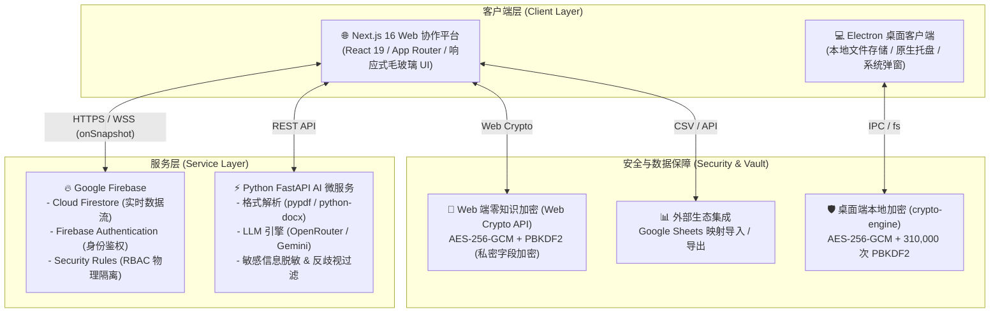

# 🌐 TALENT FLOW (Omni Recruitment Management)
### 全方位智能招聘与候选人全生命周期管理系统

<p align="center">
  
  
  
  
  
  
  
</p>

---

> [!TIP]
> 📘 **业务实操必读**：针对 HRBP、猎头顾问与团队管理员，系统提供了详尽的业务操作指南，请直接查阅 [用户操作与业务实战手册 (USER_MANUAL.md)](file:///d:/candidate_followup/USER_MANUAL.md)。
> 另外，关于外部自动化与生态集成，可参阅 [n8n 自动化部署指南](file:///d:/candidate_followup/n8n/README.md) 与 [Google Sheets 导入指南](file:///d:/candidate_followup/GOOGLE_SHEETS_GUIDE.md)。

## 📖 项目简介 (Overview)

**TALENT FLOW (Omni Recruitment Management)** 是一套专为现代猎头顾问、企业 HRBP、招聘团队及人力资源服务机构量身打造的**全方位智能招聘与候选人全生命周期管理系统**。

项目经历了从**单机高安全桌面客户端**到**云原生多租户协作 SaaS 平台 + 独立 AI 微服务**的全面演进。系统不仅提供极致丝滑的敏捷拖拽看板、360° 候选人全维度动态档案、多词空格联搜的招聘需求订单库，更深度融合了大语言模型（LLM）能力，支持一键将粗略需求或历史 JD 文档转化为四种语言/场景的专业招聘简章，并提供简历解析与 Word/PDF 双格式导出排版。

---

## 🏗️ 整体架构与双模运行机制 (System Architecture)

系统采用 **Monorepo** 架构组织，支持**云原生全功能协作模式**与**纯本地离线单机模式**双轨运行：



### 两种运行模式对比

| 维度         | 云原生协作版 (`web/` + `ai_backend/`)                        | 桌面单机版 (`/` 根目录)                           |
| :----------- | :----------------------------------------------------------- | :------------------------------------------------ |
| **技术底座** | Next.js 16 + React 19 + Tailwind/CSS + Firebase              | Electron + 原生 JavaScript (ES6) + CSS3           |
| **适用场景** | 团队多角色协同、跨地域办公、企业级招聘流程管理               | 个人独立顾问、涉密场景、无网络离线环境            |
| **数据存储** | Firebase Firestore 云端实时数据库                            | 本地操作系统 AppData 加密 JSON 文件               |
| **协同机制** | 多租户 RBAC 权限（Owner/Manager/Recruiter 审批流与数据隔离） | 单人独享，本地密码锁定                            |
| **AI 赋能**  | 集成 Python FastAPI，支持多版本 JD 生成、简历解析            | 支持本地规则化检索与模板填充                      |
| **安全机制** | 字段级端到端零知识加密 (E2EE) + Firestore 规则防穿透         | 文件级 AES-256-GCM (310,000 次 PBKDF2) 零知识加密 |

---

## 🌟 核心功能矩阵 (Key Features)

### 1. 📋 敏捷招聘流转看板 (Pipeline Kanban)
- **7 大全流程阶段流转**：
  - `初筛 (Screening)` ➔ `电话初筛 (Phone)` ➔ `面试考核 (Interview)` ➔ `Offer 发放 (Offer)` ➔ `待入职 (Pre-onboarding)` ➔ `正式入职 (Onboarding)` ➔ `入职后跟进 (Post-onboarding)`；另设独立的淘汰沉淀池。
- **极致操作手感**：
  - 集成 `@hello-pangea/dnd` 拖拽与 `react-indiana-drag-scroll` 横向鼠标平移。
  - **乐观更新 (Optimistic UI)** 机制，卡片拖拽瞬时响应，并在后台秒级完成云端 Firestore 同步。
  - 自动沉淀阶段流转时间轴（`stageHistory`），记录每次状态变更的时间点与流转轨迹。

### 2. 🗂️ 360° 候选人全景档案 (Candidate Drawer)
- **多维度信息整合**：基本履历、毕业院校、专业背景、应聘企业与意向岗位、当前阶段、应聘渠道、沟通记录。
- **面试日程与排期**：内置面试时间选择器、面试官安排、多轮次面试追踪及详细面试评价沉淀。
- **自定义跟进定时提醒**：支持针对特定候选人设定跟进日期与提醒事项，防止高意向候选人流失。
- **附件管理**：支持简历文件上传与存储，支持本地与云端直接预览与文本快速提取。

### 3. 💼 企业招聘需求与订单库 (Job Orders)
- **多词空格联搜引擎**：
  - 支持类似 `腾讯 算法 远程 高薪` 的跨字段分词组合检索。
  - 检索结果自动触发**晶体荧光高亮**（`<mark class="search-highlight">`），秒级定位匹配原因。
- **快捷筛选 Chip**：预设常用筛选标签（`急聘`、`远程`、`包三餐`、`房补`、`双休`、`可转正`、`高薪` 等），一键快速过滤。
- **一键复制岗位推荐话术**：内置社媒/微信推荐文案生成器，一键提取格式规范的职位亮点与要求，支持秒发给意向候选人。
- **候选人表单智能联动**：在录入新候选人时，公司与岗位输入框自动与现有招聘订单库联想补全。
- **私密笔记零知识保险库 (E2EE Vault)**：佣金比例、底价薪资、HR 内部评价等敏感内容，通过端到端加密后再写入云端。

### 4. 🤖 AI 智能职位描述生成与多语言引擎 (AI Parser)
基于独立构建的 **Python FastAPI 微服务**，连接大语言模型（LLM）：
- **多源数据解析**：支持上传 Word 文档 (`.docx`)、PDF (`.pdf`)、纯文本 (`.txt`)，或直接从现有订单库一键提取需求。
- **并行产出 4 份标准商用版本**：
  1. 🏢 **【内部审批/沟通版】**：专业精炼的业务与 OKR 语言，突出增编理由、对团队产出的支持与核心职责。
  2. 📢 **【对外发布版 - 中文】**：语言风格极具号召力与吸引力，包含公司亮点、晋升通道与福利。
  3. 🌐 **【对外发布版 - 英文】**：纯正欧美科技企业范式，语法严谨地道。
  4. 🌏 **【对外发布版 - 马来文】**：符合东南亚本地用语规范的精准本地化版本。
- **企业级隐私脱敏与反歧视强力过滤**：
  - **脱敏机制**：自动将真实企业名称替换为 `[XX公司]` 或 `[知名企业]`。

### 5. 📱 内部通知推送网关 (WhatsApp Bot)
系统内置基于 Node.js 与 `whatsapp-web.js` 的专属微服务，为企业打通了内部协作的即时通信闭环：
- **无缝绑定**：顾问可在“系统设置”页面录入专属 WhatsApp 号码，号码持久化至 Firestore 用户画像中。
- **自动触发**：当“候选人跟进提醒”等系统定时器到期时，除了传统的浏览器弹窗和 Web Audio 提示音，前端实时通过 POST 接口调用本地微服务，直接推送到顾问的手机。
- **免授权部署**：通过扫码接管测试号即可启动发送队列，完美绕过企业官方 API 高昂费用与模板审批限制。
  - **反歧视过滤**：物理剔除所有涉及性别、年龄、身高、种族等不合规与敏感性要求。
- **版本控制与交互增强**：
  - 历史生成记录实时同步至 Firestore，支持历史版本对比、在线就地编辑、一键复制。
  - 支持根据修改意见（Negative Prompt / Revision Note）针对特定版本重新微调生成。

### 5. 📄 智能简历构建与多格式排版导出 (CV Builder)
- **AI 智能简历提炼**：支持从候选人档案或上传的原始 PDF 简历中，一键智能结构化提取：个人简介、专业技能、教育背景、工作与项目经历。
- **实时排版预览**：所见即所得的专业排版界面，支持在线对提炼后的各项经历进行精细化编辑。
- **双格式无损导出**：
  - 导出为标准 Microsoft Word 文档（`.docx`，基于 `docx` 引擎定制排版）。
  - 导出为高清排版 PDF（`.pdf`，基于 `html2pdf.js` 精确分标打印）。

### 6. 📊 招聘全流程数据洞察与驾驶舱 (Analytics)
- **多维动态图表**（基于 `Chart.js`）：
  - **全流程转化漏斗图**：量化统计每个流转环节的通过率与流失率。
  - **候选人渠道来源分布**：直观展示内推、猎聘、Boss、官网等渠道产出比例。
  - **岗位热度与招聘周期**：分析不同业务线的招聘周期与未关闭订单积压状态。
- **多角色视图切换**：支持“团队全景视图”（Owner/Manager）与“个人专属视图”（Recruiter）一键无缝切换。

### 7. 👥 团队管理与细粒度 RBAC 权限隔离 (Team & RBAC)
基于 **Firebase Firestore Security Rules** 实现严密的后端安全隔离：
- **三级角色控制**：
  - 👑 **Owner (团队创建者/所有者)**：全功能管理，包含成员审核、角色调整、全局订单与候选人调度。
  - 🎖️ **Manager (团队主管)**：拥有团队全局数据读写权限，负责跨组协调与数据报表查看。
  - 💼 **Recruiter (招聘顾问)**：严格的数据物理隔离机制——默认仅可查看和管理分配给自身（`assignedTo == uid`）的候选人与订单。
- **成员加入审批流**：新注册用户自动进入 `pending` 待审核状态，必须经由团队 Owner 或 Manager 审批并分配角色后方可访问团队业务数据。

### 8. 🔄 生态互联与平滑迁移 (Integration & Migration)
- **单机到云端一键平滑迁移**：在 Web 端的“系统设置”中，可直接上传桌面版导出的 `candidate_data.json` 离线备份，系统自动校验并批量写入 Firestore。
- **Google Sheets 互联**：支持输入公开或授权的 Google 表格链接，自动识别工作表 ID，一键拉取候选人名单并进行字段可视化映射导入。

---

## 🗄️ 数据库规范与数据结构 (Database Schema)

关于 Firestore 数据库的集合结构、权限规则划分以及 `Candidate`、`JobOrder` 等核心数据模型的详细 TypeScript 定义与 JSON 格式规范，**请务必参阅独立的 [FIREBASE_SCHEMA.md](file:///d:/candidate_followup/FIREBASE_SCHEMA.md)**。未来的系统对接、数据迁移或 AI Agent 介入，均应以该文件为标准数据契约。

---

## 📂 项目结构全景 (Repository Structure)

```text
candidate_followup/
├── web/                               # 【云原生全栈 Web 应用】
│   ├── app/                           # Next.js 16 App Router
│   │   ├── (auth)/login/              # 用户鉴权模块 (Email/密码 + Google 登录)
│   │   ├── (dashboard)/               # 核心业务模块
│   │   │   ├── overview/              # 仪表盘工作台 (漏斗概览、今日日程、快捷入口)
│   │   │   ├── pipeline/              # 敏捷招聘看板 (横向拖拽流转)
│   │   │   ├── candidates/            # 候选人管理 (档案、标签筛选、列表视图)
│   │   │   ├── orders/                # 招聘订单库 (多词联搜、话术生成、E2EE 私密备注)
│   │   │   ├── ai-parser/             # AI 智能职位生成 (4 版本生成、历史记录、脱敏)
│   │   │   ├── cv-builder/            # 简历构建器 (PDF 提炼、Word/PDF 导出)
│   │   │   ├── calendar/              # 面试日程表 (月/周网格、排期冲突校验)
│   │   │   ├── analytics/             # 多维数据洞察 (Chart.js 图表、团队/个人视图)
│   │   │   ├── team/                  # 团队与权限管理 (成员审批、RBAC 角色分配)
│   │   │   └── settings/              # 系统设置 (本地数据迁移、E2EE 保险库设置、Google Sheets 导入)
│   │   ├── layout.js & globals.css    # 全局布局与设计系统
│   ├── components/                    # 核心通用 UI 组件
│   │   ├── CandidateDrawer.js         # 360° 候选人全维度抽屉
│   │   ├── OrderDrawer.js             # 招聘订单详情与推荐话术抽屉
│   │   ├── NotificationPanel.js       # 全局消息与定时提醒抽屉
│   │   ├── Sidebar.js & Header.js     # 现代毛玻璃导航与顶栏
│   │   ├── AuthGuard.js               # 路由守卫与鉴权包装器
│   │   └── StrictModeDroppable.js     # React 19 兼容拖拽组件包装
│   ├── lib/                           # 客户端底层服务与工具库
│   │   ├── firebase.js                # Firebase 初始化与配置
│   │   ├── firestore-store.js         # Firestore 实时数据层与 CRUD
│   │   ├── auth-context.js            # 全局用户身份状态与权限上下文
│   │   ├── crypto-web.js              # Web Crypto API 零知识客户端加密引擎
│   │   ├── ai-service.js              # AI 接口服务适配器
│   │   ├── cv-generator.js            # DOCX/PDF 简历生成核心逻辑
│   │   ├── google-sheets.js           # Google Sheets CSV 解析与映射
│   │   └── utils.js                   # 常用格式化、阶段定义与工具函数
│   ├── firestore.rules                # 严格的企业级 Firestore 权限控制规则
│   └── package.json                   # Web 端依赖配置 (Next 16, React 19, Firebase, etc.)
│
├── ai_backend/                        # 【Python AI 微服务】
│   ├── main.py                        # FastAPI 应用入口与 RESTful API 路由
│   ├── llm_service.py                 # LLM 交互引擎 (Prompt、反歧视过滤、JSON 解析)
│   ├── file_parser.py                 # 简历/文档解析器 (PyPDF、python-docx、txt)
│   ├── requirements.txt               # Python 依赖清单 (fastapi, uvicorn, openai, etc.)
│   └── .env.example                   # AI 后端环境变量模板
│
├── main.js                            # 【Electron 桌面主进程】(窗口生命周期、系统托盘、本地文件读写)
├── preload.js                         # Electron 安全预加载脚本 (ContextBridge 隔离通道)
├── index.html                         # Electron 桌面端单页主界面
├── css/                               # 桌面端原生样式系统
├── js/                                # 桌面端原生业务逻辑模块
│   ├── store.js                       # 桌面端数据中心 (防原型污染、数据清洗管道)
│   └── lib/crypto-engine.js           # 桌面端 AES-256-GCM + 310k PBKDF2 密码学引擎
├── USER_MANUAL.md                     # 【业务实战】全功能用户操作手册 (HR/顾问/管理员实操指南)
├── DEPLOYMENT.md                      # 生产环境部署说明书 (Render + Firebase 极速上线)
├── GOOGLE_SHEETS_GUIDE.md             # Google Sheets 表格数据导入说明书
├── ARCHITECTURE_NOTES.md              # 云原生演进与架构设计笔记
├── CHANGELOG.md                       # 版本更新历史日志
└── package.json                       # 根目录 Electron 桌面端配置文件
```

---

## ⚡ 快速开始与本地开发 (Quick Start)

### 📋 环境准备
在开始前，请确保您的本地开发环境中已安装：
- [Node.js](https://nodejs.org/) (建议 `v18.x` 或 `v20.x` 以上版本，包含 `npm`)
- [Python](https://www.python.org/) (建议 `v3.10` 以上版本，用于 AI 微服务)
- [Git](https://git-scm.com/)

---

### 方案 A：运行云原生 Web 全栈版 (推荐)

#### 1. 启动 Python AI 后端服务
```bash
# 1. 进入 AI 服务目录
cd ai_backend

# 2. 创建并激活虚拟环境 (可选但推荐)
python -m venv venv
# Windows 激活:
.\venv\Scripts\activate
# macOS/Linux 激活:
# source venv/bin/activate

# 3. 安装 Python 依赖
pip install -r requirements.txt

# 4. 配置环境变量
# 在 ai_backend 目录下创建 .env 文件，填入：
# OPENROUTER_API_KEY=你的OpenRouter或Gemini密钥
# AI_MODEL_NAME=google/gemini-flash-1.5

# 5. 启动开发服务器
python main.py
# 服务将在 http://localhost:8000 启动
```

#### 2. 启动 Next.js Web 前端应用
```bash
# 打开新的终端窗口，进入 web 目录
cd web

# 1. 安装前端依赖
npm install

# 2. 配置前端环境变量
# 在 web 目录下创建 .env.local 文件，填入您的 Firebase 配置和后端连接：
NEXT_PUBLIC_FIREBASE_API_KEY=your_api_key
NEXT_PUBLIC_FIREBASE_AUTH_DOMAIN=your_project.firebaseapp.com
NEXT_PUBLIC_FIREBASE_PROJECT_ID=your_project_id
NEXT_PUBLIC_FIREBASE_STORAGE_BUCKET=your_project.appspot.com
NEXT_PUBLIC_FIREBASE_MESSAGING_SENDER_ID=your_sender_id
NEXT_PUBLIC_FIREBASE_APP_ID=your_app_id
PYTHON_API_URL=http://localhost:8000

# 3. 部署或在 Firebase 控制台中配置 Firestore 安全规则
# 将 web/firestore.rules 内容粘贴到 Firebase Console -> Firestore Database -> Rules 中并发布。

# 4. 启动前端开发服务器
npm run dev
```
打开浏览器访问 [http://localhost:3000](http://localhost:3000) 即可开始使用！

---

### 方案 B：运行 Electron 桌面客户端

如果您仅需在本地离线单机运行：
```bash
# 1. 返回项目根目录
cd candidate_followup

# 2. 安装桌面端依赖
npm install

# 3. 启动开发版客户端
npm start

# 4. 打包可分发安装包 (如 .exe)
npm run build
```
打包成功后，可执行安装文件将生成在 `dist/` 目录下。

---

## 🔒 企业级安全机制 (Enterprise Security)

1. **端到端零知识加密 (Zero-Knowledge E2EE)**：
   - 系统支持在客户端使用自定义加密主密码（Vault Password）。
   - 敏感字段在离开发送端前，通过 Web Crypto API 执行 `PBKDF2 (100,000 次) + AES-256-GCM` 加密，云端仅存储密文字符串（带 `TLFL_E2EE_V1:` 签名）。即使云端数据库被完全导出，任何无密码方均无法逆向出真实数据。
2. **严格的 CSP 与深度防 XSS 防护**：
   - 全面剔除危险的 `unsafe-inline`。
   - 对外链协议施加严格白名单（如 `Utils.sanitizeUrl`），阻断 `javascript:` 伪协议注入。
   - 对所有富文本与用户展示字段实施实体转义 (`Utils.escapeHtml`)。
3. **数据管道防原型污染**：
   - 采用 `Object.create(null)` 创建无原型字典，对所有导入与同步的候选人/订单数据实施长度截断与白名单清洗。
4. **云端权限物理隔离 (Firestore Rules)**：
   - 招聘专员（Recruiter）仅拥有其名下分配候选人（`assignedTo == auth.uid`）的读写权限。
   - 团队元数据仅团队所有者（Owner）可改动，彻底防止越权提权攻击。

---

## 🚀 生产部署指南 (Production Deployment)

TALENT FLOW 支持一键部署到各大主流云平台（推荐使用 **Render** 或 **Vercel** + **Firebase**）：

- **前端部署 (Next.js)**：可一键部署至 Vercel 或 Render Web Service（根目录设置为 `web`）。
- **AI 微服务部署 (FastAPI)**：推荐部署至 Render Web Service 或 Railway / Docker 容器（根目录设置为 `ai_backend`）。
- **域名授权**：部署完成后，务必将生产域名添加到 Firebase Console 的 **Authorized domains** 列表中，以确保 Google 登录正常授权。

> 📖 **图文级详细部署指引**：请直接查阅项目内的 [DEPLOYMENT.md](file:///d:/candidate_followup/DEPLOYMENT.md)。

## 🔮 未来演进蓝图 (Roadmap / Future Ideas)

- **无人值守云端自动同步 (Unattended Background Auto-Sync)**：
  - **构想**：实现企业级的 Google Sheets 定时免密拉取与写入。允许用户在设置页面配置多个同步规则（如每小时拉取一次表格 A 存为候选人，拉取表格 B 存为订单）。
  - **架构规划**：引入 `firebase-admin` 赋能 Node.js 服务器级特权写入；搭建 `/api/cron/sync` 触发器接口；结合外部 Cron 平台（如 cron-job.org / GitHub Actions）或独立微服务实现定时唤醒。
  - **安全性考量**：需要严格管控 Service Account 密钥，防范全量数据覆盖及未授权 webhook 调用。

---

## 📜 许可证 (License)

本项目遵循 [MIT License](file:///d:/candidate_followup/package.json) 开源协议。您可以自由地在此基础上进行二次开发、修改与商用部署。

## 💻 以后日常手动启动服务的命令
如果您未来重启电脑或想在新的终端窗口手动启动，这里是各个子服务的启动命令：

```powershell
# 1. 启动 Web 前端 (Next.js)
cd web
npm run dev
```
提示：浏览器打开 http://localhost:3000 即可使用系统。

```powershell
# 2. 启动 Python AI 后端 (微服务)
cd ai_backend
# 推荐使用虚拟环境中的 Python 直接启动：
.\venv\Scripts\python.exe -m uvicorn main:app --reload --port 8000
# 或者激活虚拟环境后再运行：
# .\venv\Scripts\activate
# python -m uvicorn main:app --reload --port 8000
```

```powershell
# 3. 启动 WhatsApp 候选人通知机器人 (个人号，端口 8002)
cd whatsapp_bot
$env:ROLE="personal"
npm start
```
提示：启动后将运行在 http://localhost:8002。首次启动时请使用【发送给候选人】的 WhatsApp 账号扫码登录。

```powershell
# 4. 启动 WhatsApp 内部通知机器人 (公司号，端口 8003)
cd whatsapp_bot
$env:ROLE="company"
npm start
```
提示：启动后将运行在 http://localhost:8003。首次启动时请使用【公司内部通知】的 WhatsApp 账号扫码登录。

```powershell
# 5. 启动 n8n 工作流引擎 (Docker，端口 5678)
docker start talentflow_n8n
```
提示：访问 http://localhost:5678 即可进入 n8n 控制台。

```powershell
# 6. 启动 ngrok 外网隧道 (为 n8n 提供公网 Webhook 域名)
ngrok http --domain=unsafe-islamist-idealist.ngrok-free.dev 5678
```
提示：启动后外部可通过 https://unsafe-islamist-idealist.ngrok-free.dev 访问 n8n，供 Telegram Bot / Google Sheets 接收推送。

