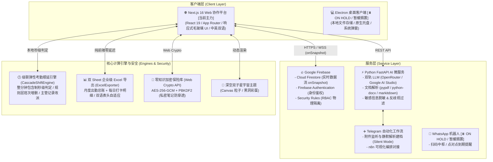

# 🌐 TALENT FLOW (Omni Recruitment Management)
### 全方位智能招聘、弹性考勤与候选人全生命周期管理系统

<p align="center">
  
  
  
  
  
  
  
  
</p>

---

> [!TIP]
> 📘 **核心文档索引**：
> - **业务实战**：HRBP、顾问与团队管理员请查阅 [用户操作与业务实战手册 (USER_MANUAL.md)](file:///d:/candidate_followup/USER_MANUAL.md)。系统 Web 端亦内置高质感交互式帮助中心（访问路由 `/docs`）。
> - **生产部署**：多容器编排与云平台上线指引请参考 [生产部署指引 (DEPLOYMENT.md)](file:///d:/candidate_followup/DEPLOYMENT.md)。
> - **数据契约**：Firestore 集合架构与 TypeScript 实体规范请参阅 [数据模型契约 (FIREBASE_SCHEMA.md)](file:///d:/candidate_followup/FIREBASE_SCHEMA.md)。
> - **外部生态**：Telegram 自动化工作流与 Google 表格导入请参考 [n8n 部署指南](file:///d:/candidate_followup/n8n/README.md) 与 [Google Sheets 导入指南](file:///d:/candidate_followup/GOOGLE_SHEETS_GUIDE.md)。

---

## 📖 项目简介 (Overview)

**TALENT FLOW (Omni Recruitment Management)** 是一套专为现代猎头顾问、企业 HRBP、招聘团队及人力资源服务机构量身打造的**全方位智能招聘、弹性考勤与候选人全生命周期管理系统**。

系统以**云原生多租户协作 SaaS 平台**为主轴，深度串联 **Python FastAPI AI 微服务** 与 **Telegram / n8n 自动化流水线**。系统不仅提供极致丝滑的敏捷拖拽看板、360° 候选人全维度动态档案、多词空格联搜的企业订单库，更深度融合了大语言模型（LLM）能力（4 版本专业职位描述生成、简历提炼与 Word/PDF 双格式导出排版）。

此外，系统全新重构集成了**阶梯弹性考勤顺延引擎**（整分钟包含制秒级判定、4 档班次自由定制、主管单日记录人工改派、严重迟到末档锁定、双 Sheet 纯前端双语 Excel 导出）、**公司本部专属考勤与销售双竞技排行榜**、**深空双子星三态主题**及**全链路中英双语国际化 (i18n)**，提供兼具工业级严密性与消费级美学体验的招聘数字化闭环。

---

## 🏗️ 整体架构与双模运行机制 (System Architecture)

系统采用 **Monorepo** 架构组织，支持**云原生全功能协作主模式**与**纯本地离线单机模式**：



### 两种运行模式状态说明

| 维度 | 云原生 SaaS 协作版 (`web/` + `ai_backend/`) | 桌面单机版 (`/` 根目录) |
| :--- | :--- | :--- |
| **状态标记** | **🟢 当前主力开发与演进核心 (Active)** | **⏸️ 已暂缓搁置 (On Hold，存量保留)** |
| **技术底座** | Next.js 16.4.2 + React 19.2.8 + Tailwind CSS | Electron 44 + 原生 JavaScript (ES6) + CSS3 |
| **适用场景** | 团队多角色协同、跨地域办公、企业招聘与考勤管理 | 个人独立顾问离线单机、涉密局域网环境 |
| **数据存储** | Firebase Firestore 云端实时数据库 | 本地操作系统 AppData 加密 JSON 文件 |
| **协同机制** | 多租户 RBAC 权限（Owner/Manager/Recruiter 数据物理隔离） | 单人独享，本地密码锁定 |
| **AI & 自动化**| 集成 Python FastAPI、Telegram 自动建档、n8n 工作流 | 本地规则化检索与模板填充 |
| **安全机制** | 字段级端到端零知识加密 (E2EE) + Firestore 规则防穿透 | 文件级 AES-256-GCM (310,000 次 PBKDF2) 零知识加密 |

---

## 🌟 核心功能矩阵 (Key Features)

### 1. 📋 敏捷招聘流转看板 (Pipeline Kanban)
- **7 大全流程阶段流转**：
  - `初筛 (Screening)` ➔ `电话初筛 (Phone)` ➔ `面试考核 (Interview)` ➔ `Offer 发放 (Offer)` ➔ `待入职 (Pre-onboarding)` ➔ `正式入职 (Onboarding)` ➔ `入职后跟进 (Post-onboarding)`；另设独立的淘汰沉淀池。
- **极致手感与交互**：
  - 基于 `@hello-pangea/dnd` 拖拽与 `react-indiana-drag-scroll` 横向鼠标平滑滚动。
  - **乐观更新 (Optimistic UI)** 机制，卡片拖拽瞬时吸附，后台秒级完成云端 Firestore 同步。
  - 自动沉淀阶段流转时间轴（`stageHistory`），完整保留每次状态跃迁的时间节点与操作记录。

### 2. 🗂️ 360° 候选人全景档案 (Candidate Drawer)
- **全要素动态履历**：基本信息、教育背景、专业技能、意向岗位、渠道来源、阶段状态与全生命周期跟进历史。
- **面试排期与日程看板**：内置时间选择器、面试官安排、多轮次面试评估记录及排期冲突实时检测。
- **跟进提醒系统**：自定义跟进日期与提醒备忘，结合顶部通知栏与桌面 Web Audio 音效，防止高意向候选人流失。
- **简历文本一键提取**：支持简历附件上传与预览，集成前端快速文本解析提取。

### 3. 💼 企业招聘需求与订单库 (Job Orders & E2EE Vault)
- **多词空格联搜引擎**：
  - 支持类似 `腾讯 算法 远程 高薪` 的跨字段分词组合检索。
  - 检索命中区域自动触发**晶体荧光高亮**（`<mark class="search-highlight">`），秒级定位匹配原因。
- **快捷筛选 Chip**：预设 `急聘`、`远程`、`包三餐`、`房补`、`双休`、`可转正`、`高薪` 等标签，一键快速收敛。
- **一键社媒推荐话术生成**：内置社媒/微信文案格式化生成器，一键提取职位亮点与福利，秒发意向候选人。
- **表单智能联动**：在录入新候选人时，公司与岗位输入框自动与现有订单库联想补全。
- **私密笔记零知识保险库 (E2EE Vault)**：佣金比例、底价薪资、HR 内部评价等核心敏感商业机密，通过客户端 `AES-256-GCM` 加密后再写入云端。

### 4. 🕒 企业级考勤打卡与弹性阶梯排班系统 (Corporate Attendance & Shift Engine) ⭐
系统专为弹性工作制企业量身打造了高精度、防作弊、全链路数字化的智能考勤打卡子系统：
- **纯前端整分钟包含制秒级判定 (Minute-inclusive Window)**：
  - 核心算法纯函数类 `CascadeShiftEngine`，告别粗暴的分钟向下取整；
  - 规则设定在 `08:30:59` 及之前打卡依然稳稳计入 8:30 班次（Shift C，17:30 下班），时钟跳至 `08:31:00` 时才严格顺延至 9:00 班次（Shift D，18:00 下班），杜绝“卡秒误伤”。
- **全动态阶梯班次自由配置 (Rule Tier Customization)**：
  - 规则层彻底告别写死逻辑，考勤规则弹窗重构为全动态可编辑表格；
  - 班次名称、签到基准线（`<input type="time">`）与要求强制下班底线均支持自由配置；
  - 支持“➕ 添加班次档位”（自动递增）、“🗑️ 删除班次”及“🔄 一键恢复默认4档”；保存时自动执行时间合法性校验与按起始时间升序排列。
- **主管单日考勤记录人工改派 (Shift Override & Audit Logs)**：
  - 考勤明细列表中针对 Owner / Manager 开放行级“✏️ 改班”入口；
  - 支持单日记录下拉人工改派目标班次，或一键“⚡ 恢复系统自动判定”；
  - 改派后自动以新班次的下班底线重新核定考勤合规、早退判定与工时达标；
  - 记录醒目附带 `[主管调整]` 徽章，悬停可实时查阅调整人、时间戳与调整理由，生成不可篡改审计追踪。
- **严重迟到末档自动继承锁定 (Strict Late Fallback)**：
  - 打卡时间超过 09:00 或下午打卡无法命中前置班次时，自动指派并锁定到最迟班次（Shift D: 18:00 下班）；
  - 强制继承末档下班底线，同时标记为 `isLateArrival: true`，彻底杜绝打卡不达标导致的“提前偷跑早退”漏洞。
- **企业级双 Sheet 考勤月报导出 (ExcelExporter)**：
  - 纯前端零延迟生成标准 Excel 报表（Sheet 1：月度出勤总账；Sheet 2：每日打卡明细）；
  - 全自适应中英双语表头与字段名（`Attendance Summary` / `Daily Punch Log Details`）；
  - 内置 XML Spreadsheet 违规单元格样式判定，迟到、早退、严重违规自动呈现红字醒目预警。
- **悬浮打卡入口与实时班次预览**：
  - 全局快速悬浮球（`GlobalQuickFab`）随时唤起打卡弹窗；
  - 实时跳动的数字时钟下方动态显示当前命中的班次与下班底线预览；
  - 具备企业网络 IP 自动白名单检测与一键快捷绑定。

### 5. 🏆 公司本部专属考勤与销售业绩双竞技榜单 (HQ Leaderboard) ⭐
- **公司本部专属隔离 (HQ-Exclusive Scope)**：
  - 侧边栏常驻奖杯入口，严格隔离外部分部与独立合作人数据，仅限公司本部团队参与；
- **双轨竞技排行榜**：
  - 💼 **销售业绩榜 (Sales Performance)**：统计成单入职数 (Onboarded)、Offer 发放数、面试考核数、简历推荐量、成单转化率与综合竞技积分；
  - 🕒 **考勤出勤榜 (Attendance)**：统计实际出勤天数 (Days Present)、办公室在岗打卡、居家 WFH 打卡、出勤率与勤奋达标指数；
- **现代错层立体领奖台 (Podium UI)**：
  - 顶部设立冠亚季军（#2 银、#1 金、#3 铜）立体领奖台，下方搭配全员明细指标表格与进度条。

### 6. 🤖 AI 智能职位描述生成与多语言引擎 (AI Parser)
基于独立构建的 **Python FastAPI 微服务**，双轨支持 OpenRouter 与 Google AI Studio：
- **多源数据解析**：支持上传 Word (`.docx`)、PDF (`.pdf`)、纯文本 (`.txt`) 或直接从现有招聘订单提取。
- **并行产出 4 份标准商用版本**：
  1. 🏢 **【内部审批/沟通版】**：专业精炼的业务与 OKR 语言，突出增编理由与核心职责。
  2. 📢 **【对外发布版 - 中文】**：语言风格极具号召力与吸引力，包含公司亮点、晋升通道与福利。
  3. 🌐 **【对外发布版 - 英文】**：纯正欧美科技企业范式，语法严谨地道。
  4. 🌏 **【对外发布版 - 马来文】**：符合东南亚本地用语规范的精准本地化版本。
- **隐私脱敏与反歧视强力过滤**：
  - 自动将真实企业名称替换为 `[XX公司]` 或 `[知名企业]`。
  - 物理剔除所有涉及性别、年龄、身高、种族等敏感与歧视性要求。
- **历史记录与就地微调**：
  - 生成结果云端实时存档，支持版本对比、在线编辑以及针对特定版本的 Negative Prompt 重新微调。

### 7. 📄 智能简历提炼与多格式排版导出 (CV Builder)
- **AI 智能简历解析**：从候选人档案或上传的 PDF 简历中，一键结构化提取个人简介、专业技能、教育背景、工作经历。
- **所见即所得排版**：提供现代化排版预览界面，支持就地实时微调各项经历。
- **双格式无损导出**：
  - 导出为标准 Microsoft Word 文档（`.docx`，基于定制样式引擎）。
  - 导出为高清排版 PDF（`.pdf`，基于 `html2pdf.js` 精确分标打印）。

### 8. ✈️ Telegram 自动简历解析与建档工作流 (Telegram Automated Workflow) ⭐
- **群聊与私聊附件监听**：
  - 机器人静默接入顾问工作群，自动嗅探群内上传的 Word/PDF 简历；
  - **规范命名线索挖掘**：智能识别 `公司 - 岗位 - 姓名.docx` 命名规范，精准提取企业与意向岗位线索注入 AI 解析上下文。
- **纯静默监听模式 (Pure Silent Mode)**：
  - 支持配置 `TELEGRAM_SILENT_MODE=true`，后台静默下载、AI 提取与建档，不向群聊发送任何消息，彻底杜绝打扰顾问日常工作对话。
- **n8n 可视化编排对接**：
  - 提供现成的 `talentflow_telegram_workflow.json` 工作流模板，支持通过 Webhook 接收外部文件流并批量同步建档。

### 9. 🌌 深空双子星三态主题与交互宇宙 (Cosmic & Gemini Theme) ⭐
- **三态主题切换**：支持 `Light`（明亮清爽）、`Dark`（深邃暗黑）与 `Gemini`（深空双子星）三态无缝切换。
- **动态星空粒子画布 (`CosmicBackground.js`)**：HTML5 Canvas 动态渲染繁星闪烁、微光星云与划过的流星，页面切入后台时自动进入休眠节电模式。
- **微型黑洞物理彩蛋 (`MiniBlackHole.js`)**：在双子星主题下内嵌吸积盘粒子模拟与引力透镜弯曲物理动画。

### 10. 💬 系统建议与意见反馈中心 (Feedback Center) ⭐
- **全局快速触达**：屏幕右下角全局悬浮球（`GlobalQuickFab`）随时唤起反馈模态框；
- **全要素收集与流转**：涵盖 Bug 报告、体验建议、系统吐槽等分类，关联严重程度、当前路由上下文与处理进度，直存 Firestore 安全集合。

### 11. 🌐 全链路中英双语国际化体系 (Bilingual i18n Engine) ⭐
- **零硬编码中文**：考勤打卡弹窗、实时预览卡片、倒计时防呆、错误边界提示、订单库、数据分析大屏及 Excel 导出均全面接入 `web/lib/i18n`；
- **一键即时切换**：顶栏语言切换器（中/EN）一键响应，持久化用户语言偏好。

### 12. 📊 招聘全流程数据洞察与驾驶舱 (Analytics Dashboard)
- **多维动态图表**（基于 `Chart.js`）：全流程转化漏斗、候选人渠道来源分布、招聘周期与未关闭订单积压统计。
- **多角色视图切换**：支持“团队全景视图”（Owner/Manager）与“个人专属视图”（Recruiter）一键无缝切换。

### 13. 👥 团队管理与细粒度 RBAC 权限隔离 (Team & RBAC)
基于 **Firebase Firestore Security Rules** 实现严密的后端安全隔离：
- **三级角色控制**：
  - 👑 **Owner (团队创建者/所有者)**：全功能管理，包含成员审核、角色调整、全局订单与候选人调度。
  - 🎖️ **Manager (团队主管)**：拥有团队全局数据读写权限，负责跨组协调与数据报表查看。
  - 💼 **Recruiter (招聘顾问)**：严格的数据物理隔离——默认仅可查看和管理分配给自身（`assignedTo == uid`）的候选人与订单。
- **成员加入审批流**：新注册用户自动进入 `pending` 待审核状态，必须经由团队 Owner 或 Manager 审批并分配角色后方可访问团队业务数据。

### 14. 🔄 生态互联与平滑迁移 (Google Sheets & JSON Migration)
- **单机到云端一键平滑迁移**：在 Web 端的“系统设置”中，可直接上传桌面版导出的 `candidate_data.json` 离线备份，系统自动校验并批量写入 Firestore。
- **Google Sheets 互联**：支持输入 Google 表格链接，自动识别工作表 ID，一键拉取候选人名单并进行字段可视化映射导入。

### 15. 📱 内部通知推送网关 (WhatsApp Bot) `[⏸️ ON HOLD / 暂缓搁置]`
- 基于 Node.js 与 Baileys 的扫码机器人中枢（位于 `whatsapp_bot/`），目前系统已将其作为存量能力保留，日常业务优先推荐 Web 端与 Telegram/系统通知。

---

## 📂 项目结构全景 (Repository Structure)

```text
candidate_followup/
├── web/                               # 【云原生全栈 Web 应用】(Next.js 16 + React 19)
│   ├── app/                           # Next.js App Router 路由体系
│   │   ├── (auth)/login/              # 用户鉴权模块 (Email/密码 + Google 登录)
│   │   ├── (dashboard)/               # 核心业务大厅
│   │   │   ├── overview/              # 仪表盘工作台 (漏斗概览、今日日程、快捷入口)
│   │   │   ├── pipeline/              # 敏捷招聘看板 (7 阶段拖拽流转)
│   │   │   ├── candidates/            # 候选人管理 (档案、标签筛选、列表视图)
│   │   │   ├── orders/                # 招聘订单库 (多词联搜、话术生成、E2EE 私密备注)
│   │   │   ├── ai-parser/             # AI 智能职位生成 (4 版本生成、历史记录、脱敏)
│   │   │   ├── cv-builder/            # 简历构建器 (PDF 提炼、Word/PDF 导出)
│   │   │   ├── calendar/              # 面试日程表 (月/周网格、排期冲突校验)
│   │   │   ├── analytics/             # 数据洞察与考勤明细 (Chart.js、考勤规则弹窗、主管改班)
│   │   │   ├── leaderboard/           # 公司本部专属排行榜 (销售业绩榜 + 考勤出勤榜)
│   │   │   ├── feedback/              # 系统建议与意见反馈中心
│   │   │   ├── team/                  # 团队与权限管理 (成员审批、RBAC 角色分配)
│   │   │   ├── docs/                  # 系统交互式业务手册与全景指南
│   │   │   └── settings/              # 系统设置 (本地数据迁移、E2EE 保险库设置、Google 表格导入)
│   │   ├── api/attendance/            # 考勤打卡服务端 Edge/Node API Routes (IP 获取与鉴权校验)
│   │   └── layout.js & globals.css    # 全局布局与设计系统
│   ├── components/                    # 核心通用 UI 组件
│   │   ├── AttendanceModal.js         # 智能考勤打卡弹窗 (秒级时钟、班次动态预览、防呆签退)
│   │   ├── CandidateDrawer.js         # 360° 候选人全维度抽屉
│   │   ├── OrderDrawer.js             # 招聘订单详情与推荐话术抽屉
│   │   ├── GlobalQuickFab.js          # 全局右下角快速操作悬浮球 (打卡入口、意见反馈)
│   │   ├── CosmicBackground.js        # Canvas 深空宇宙粒子星空背景
│   │   ├── MiniBlackHole.js           # 微型黑洞引力透镜物理彩蛋
│   │   ├── NotificationPanel.js       # 全局消息与定时提醒抽屉
│   │   ├── Sidebar.js & Header.js     # 现代毛玻璃导航与顶栏
│   │   └── AuthGuard.js               # 路由守卫与 RBAC 鉴权包装器
│   ├── lib/                           # 客户端底层服务与纯函数计算内核
│   │   ├── cascade-shift-engine.js    # 级联弹性考勤顺延算法内核 (整分钟包含、迟到末档锁定、改派)
│   │   ├── excel-exporter.js          # 企业级多 Sheet Excel 导出引擎 (双语表头自适应)
│   │   ├── firebase.js                # Firebase 初始化与配置
│   │   ├── firestore-store.js         # Firestore 实时数据层与 CRUD
│   │   ├── auth-context.js            # 全局用户身份状态与权限上下文
│   │   ├── crypto-web.js              # Web Crypto API 零知识客户端加密引擎
│   │   ├── i18n/                      # 中英双语全链路国际化字典库
│   │   └── utils.js                   # 常用格式化、阶段定义与工具函数
│   ├── firestore.rules                # 严格的企业级 Firestore 权限控制规则
│   └── package.json                   # Web 端依赖配置 (Next 16, React 19, Firebase, etc.)
│
├── ai_backend/                        # 【Python AI 微服务】
│   ├── main.py                        # FastAPI 应用入口与 RESTful API 路由
│   ├── services/                      # 核心微服务模块
│   │   ├── core_llm.py                # LLM 双轨自适应交互引擎 (OpenRouter / Google AI Studio)
│   │   ├── file_parser.py             # 简历/文档解析器 (PyPDF、python-docx、markitdown)
│   │   └── telegram_service.py        # Telegram 简历自动监听与静默解析建档流水线
│   ├── requirements.txt               # Python 依赖清单 (fastapi, uvicorn, openai, etc.)
│   └── .env.example                   # AI 后端环境变量模板
│
├── telegram_bot/                      # 【Telegram 自动化机器人服务】(Node.js Telegraf 备用方案)
├── whatsapp_bot/                      # 【WhatsApp 扫码机器人中枢】[⏸️ ON HOLD / 暂缓搁置]
├── n8n/                               # 【n8n 可视化编排工作流】(含 Telegram 导入模板与 Docker 部署)
├── docker-compose.yml                 # 工业级多容器联合编排文件
│
├── main.js                            # 【Electron 桌面主进程】[⏸️ ON HOLD / 暂缓搁置]
├── preload.js                         # Electron 安全预加载脚本
├── index.html                         # Electron 桌面端单页主界面
├── css/ & js/                         # 桌面端样式与逻辑中心
├── USER_MANUAL.md                     # 【业务实战】全功能用户操作手册 (HR/顾问/管理员实操指南)
├── DEPLOYMENT.md                      # 生产环境部署说明书 (Render / Docker / Vercel 极速上线)
├── FIREBASE_SCHEMA.md                 # 数据库规范与数据模型契约
├── CHANGELOG.md                       # 版本更新历史日志
└── package.json                       # 根目录 Electron 桌面端配置文件
```

---

## ⚡ 快速开始与本地开发 (Quick Start)

### 📋 环境准备
在开始前，请确保您的本地开发环境中已安装：
- [Node.js](https://nodejs.org/) (必须 `v20.x` 以上版本，建议 `v20.18.0`)
- [Python](https://www.python.org/) (建议 `v3.11` 以上版本，用于 AI 微服务)
- [Git](https://git-scm.com/)

---

### 方案 A：运行云原生 Web 全栈版 (主力推荐)

#### 1. 启动 Python AI 后端服务
```bash
# 1. 进入 AI 服务目录
cd ai_backend

# 2. 创建并激活虚拟环境 (推荐)
python -m venv venv
# Windows 激活:
.\venv\Scripts\activate
# macOS/Linux 激活:
# source venv/bin/activate

# 3. 安装 Python 依赖
pip install -r requirements.txt

# 4. 配置环境变量
# 在 ai_backend 目录下创建 .env 文件，填入：
# GEMINI_API_KEY=你的Gemini API密钥
# GEMINI_MODEL_PRO=gemini-3.1-pro-preview
# GEMINI_MODEL_FLASH=gemini-3.8-flash

# 5. 启动开发服务器
python main.py
# 服务将在 http://localhost:8000 启动
```

#### 2. 启动 Next.js Web 前端应用
```bash
# 打开新的终端窗口，进入 web 目录
cd web

# 1. 安装前端依赖
npm install

# 2. 配置前端环境变量
# 在 web 目录下创建 .env.local 文件，填入 Firebase 配置与后端地址：
NEXT_PUBLIC_FIREBASE_API_KEY=your_api_key
NEXT_PUBLIC_FIREBASE_AUTH_DOMAIN=your_project.firebaseapp.com
NEXT_PUBLIC_FIREBASE_PROJECT_ID=your_project_id
NEXT_PUBLIC_FIREBASE_STORAGE_BUCKET=your_project.appspot.com
NEXT_PUBLIC_FIREBASE_MESSAGING_SENDER_ID=your_sender_id
NEXT_PUBLIC_FIREBASE_APP_ID=your_app_id
PYTHON_API_URL=http://localhost:8000

# 3. 部署或在 Firebase 控制台中配置 Firestore 安全规则
# 将 web/firestore.rules 内容发布到 Firebase Console。

# 4. 启动前端开发服务器
npm run dev
```
打开浏览器访问 [http://localhost:3000](http://localhost:3000) 即可开始体验！

---

### 方案 B：使用 Docker Compose 一键拉起完整集群

系统提供了生产级的容器编排方案：
```bash
# 在项目根目录执行
docker-compose up -d --build
```
启动后：
- Web 前端：[http://localhost:3000](http://localhost:3000)
- AI 后端 API：[http://localhost:8000](http://localhost:8000)

---

## 🔒 企业级安全机制与低内存守护 (Security & Guards)

1. **端到端零知识加密 (Zero-Knowledge E2EE)**：
   - 系统支持在客户端使用自定义加密主密码（Vault Password）。
   - 敏感字段在离开发送端前，通过 Web Crypto API 执行 `PBKDF2 (100,000 次) + AES-256-GCM` 加密，云端仅存储密文字符串（带 `TLFL_E2EE_V1:` 签名）。即使云端数据库被完全导出，任何无密码方均无法逆向出真实数据。
2. **严格的 CSP 与深度防 XSS 防护**：
   - 全面剔除危险的 `unsafe-inline`。
   - 对外链协议施加严格白名单（`Utils.sanitizeUrl`），阻断 `javascript:` 伪协议注入。
   - 对所有富文本与用户展示字段实施实体转义 (`Utils.escapeHtml`)。
3. **数据管道防原型污染**：
   - 采用 `Object.create(null)` 创建无原型字典，对所有导入与同步的候选人/订单数据实施长度截断与白名单清洗。
4. **云端权限物理隔离 (Firestore Rules)**：
   - 招聘专员（Recruiter）仅拥有其名下分配候选人（`assignedTo == auth.uid`）的读写权限。
   - 团队元数据仅团队所有者（Owner）可改动，彻底防止越权提权攻击。
5. **云端轻量容器 (512MB RAM) Next.js 单 Worker 打包与内存守护**：
   - `web/next.config.mjs` 配置 `experimental: { cpus: 1, workerThreads: false }`，将页面编译强制收敛为单线程，打包峰值内存从 1GB+ 骤降至 250MB~300MB；
   - `build` 脚本注入 `node --max-old-space-size=400`，严格将 Node 堆内存限制在 400MB 内，预留 112MB 操作系统缓冲区，彻底根治云端 512MB Starter 容器上频发的 `OOM Killer (Exit Code 137)` 崩溃问题。

---

## 💻 日常核心启动命令速查 (Daily Operations)

如果您重启电脑或想在新的终端窗口手动启动各服务，推荐运行以下常用命令：

```powershell
# 1. 启动 Web 前端 (Next.js - 端口 3000)
cd web
npm run dev
# 浏览器访问 http://localhost:3000
```

```powershell
# 2. 启动 Python AI 后端 (微服务 - 端口 8000)
cd ai_backend
.\venv\Scripts\python.exe -m uvicorn main:app --reload --port 8000
# 后端 API 文档：http://localhost:8000/docs
```

```powershell
# 3. 启动 n8n 工作流引擎 (Docker - 端口 5678)
docker start talentflow_n8n
# 控制台访问：http://localhost:5678
```

```powershell
# 4. [可选] 启动 ngrok 外网隧道 (为 n8n 提供公网 Webhook 域名)
ngrok http --domain=unsafe-islamist-idealist.ngrok-free.dev 5678
```

> **注**：原 `whatsapp_bot` 服务目前已处于 `[⏸️ ON HOLD]` 状态，日常开发无需启动。

---

## 📜 许可证 (License)

本项目遵循 [MIT License](file:///d:/candidate_followup/package.json) 开源协议。您可以自由地在此基础上进行二次开发、修改与商用部署。
